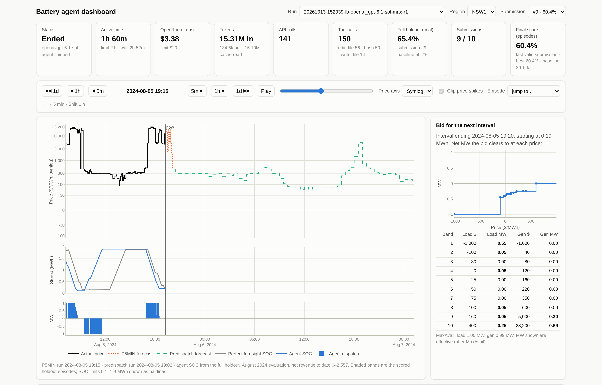
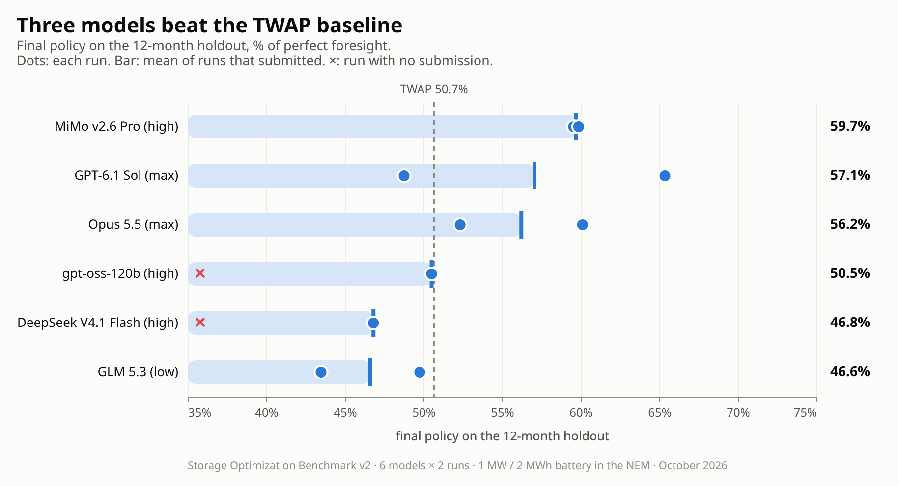
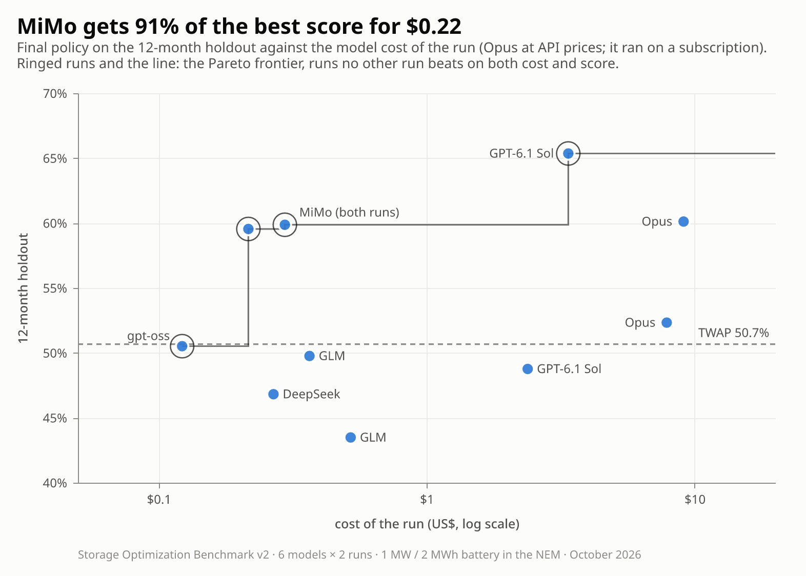
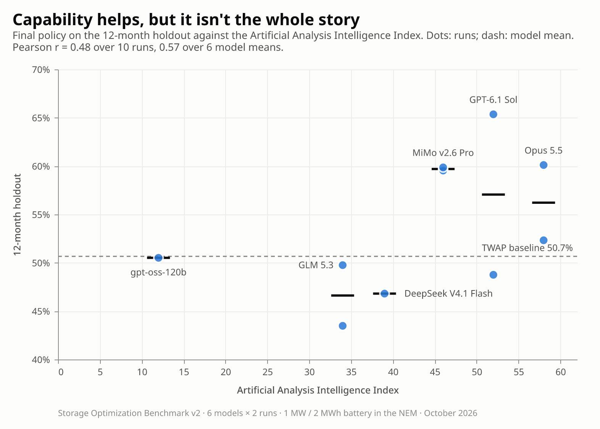
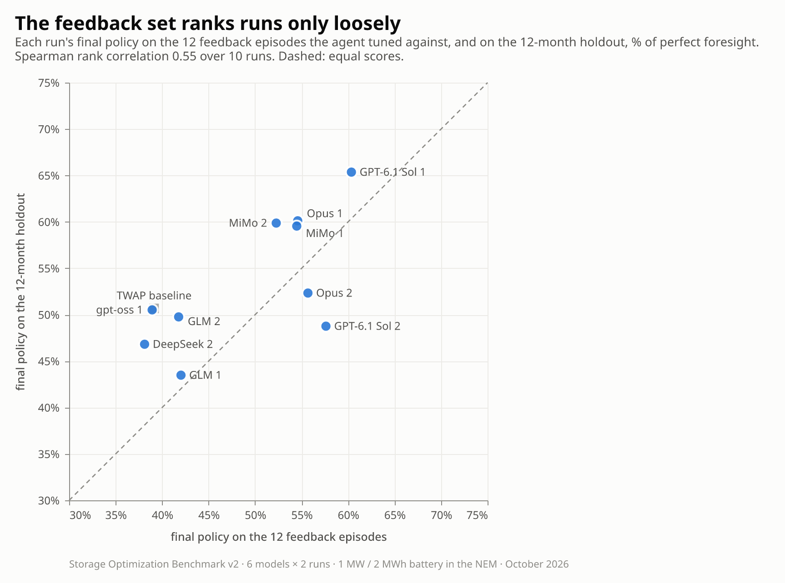
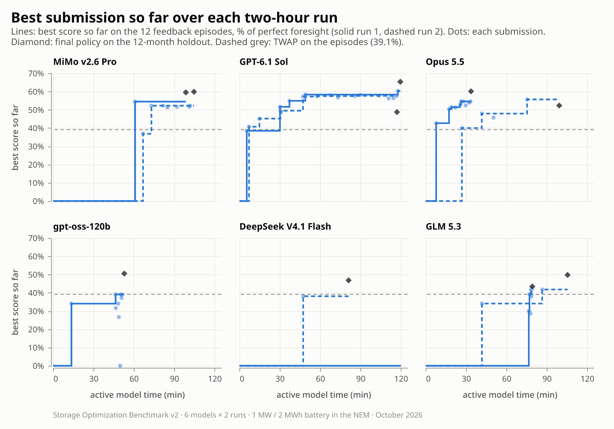
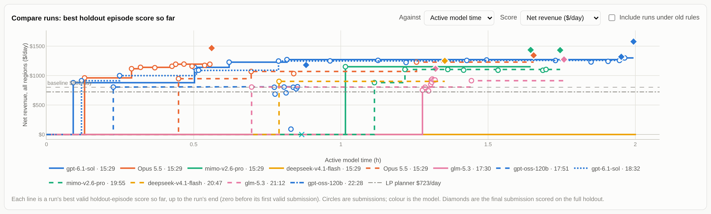
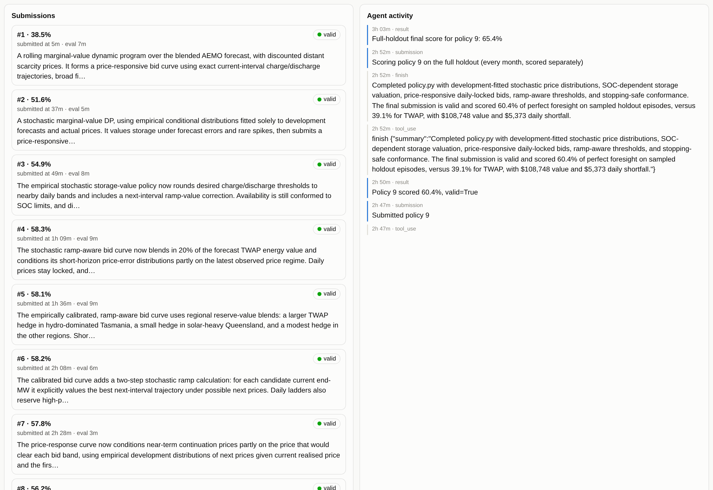

# Storage Optimization Benchmark

Can an AI agent write a bidding policy for a grid battery? Each model gets a sandboxed workspace, real Australian
electricity market (NEM) data and two hours to write a policy that bids a 1 MW / 2 MWh battery into the 5-minute
energy market. The policy is then run on 12 months of market data it never saw, in all five NEM regions, bidding the
way a real battery does: price-responsive bid curves submitted ahead of each interval, under AEMO's bidding rules,
using only the forecasts published at the time.

A [dashboard](#the-dashboard-watch-the-agents-bid) replays every run: scrub through any day of the holdout to see the
prices, the forecasts the policy had, the bids it submitted and how it charged and discharged, next to a
perfect-foresight operator, along with each submission's code and the agent's own account of what it built.



## Results (benchmark v2, October 2026)



Six models, two runs each. The score is the final policy on the 12-month holdout as a percentage of what a
perfect-foresight operator would earn (see *Scoring* below).

| Model (effort) | AA index | Runs | Mean | Feedback episodes | $/MW/yr | Cost per run |
|---|---|---|---|---|---|---|
| MiMo v2.6 Pro (high) | 46 | 59.5, 59.9 | **59.7** | 53.4 | $101k | $0.26 |
| GPT-6.1 Sol (max) | 52 | 65.4, 48.8 | **57.1** | 59.0 | $96k | $2.88 |
| Opus 5.5 (max) | 58 | 60.1, 52.3 | **56.2** | 55.1 | $95k | $8.49 |
| gpt-oss-120b (high) | 12 | 50.5, — | **50.5** | 38.9 | $85k | $0.07 |
| DeepSeek V4.1 Flash (high) | 39 | —, 46.8 | **46.8** | 38.1 | $79k | $0.22 |
| GLM 5.3 (low) | 34 | 43.5, 49.8 | **46.6** | 41.9 | $79k | $0.44 |
| *TWAP baseline* | | | *50.7* | *39.1* | *$85k* | |

- **AA index:** the Artificial Analysis Intelligence Index at the effort each model ran at, checked 12–13 October 2026
  (DeepSeek and GLM aren't listed at exactly our setting).
- **Mean:** over runs that submitted; — is a run with no submission.
- **Feedback episodes:** the same final policies on the 12 seven-day episodes the agents got feedback on.
- **$/MW/yr:** the score's dollar value for one 1 MW battery, averaged over the five regions; perfect foresight is
  $168k.
- **Cost per run:** model cost; Opus at API prices (it ran on a subscription).

What stands out:

- **Three models beat the TWAP baseline**, all by building dynamic-programming policies that value stored energy from
  AEMO's forecasts. The best single run is GPT-6.1 Sol's first, at 65.4%.
- **MiMo v2.6 Pro has the best mean for about 25 cents a run**, both runs within half a point of each other.

  

- **General capability only partly predicts the result.** Against the Artificial Analysis Intelligence Index the
  correlation is 0.57 over model means on the holdout (permutation p = 0.12), but 0.80 on the feedback episodes
  (p = 0.02): smarter models fit the episodes they tune against better, and some of that advantage washes out over the
  full year.

  

- **The feedback set ranks runs only loosely** (Spearman 0.55 over 10 runs). GPT-6.1 Sol's second run looked as good
  as its first on the episodes and lost 9 points on the holdout.

  

- **Runs with no submission:** DeepSeek's first run spent its two hours on long local experiments and was cut off
  mid-test; gpt-oss's second used up its 30 nudges in two minutes without working on the task.



Caveats:

- **Two runs per model.** Spreads between a model's runs are often as large as the gaps between models, so read the
  ranking as indicative.
- **A price-taking battery.** The simulated battery earns the full market price, which is realistic for one small
  battery but not for a fleet: in scarcity intervals a few hundred MW of extra supply can collapse the price. The
  benchmark's dollar figures are therefore an upper bound: on actual (unmapped) prices the TWAP baseline's gross
  trading revenue was 2.2× what the real NEM battery fleet earned from energy in the same months (1.4× counting the
  fleet's FCAS revenue). Rankings between policies are unaffected, since every policy faces the same prices.
  [`notebooks/price_elasticity.ipynb`](notebooks/price_elasticity.ipynb) measures this with AEMO's own price
  sensitivities: a 100–200 MW fleet running the TWAP baseline's dispatch would earn about 35% less on the mainland.
- **Prices are mapped onto today's market price cap** (see *Pulling data*), which raises spike prices in earlier
  years.

The figures come from [`notebooks/headline_figures.ipynb`](notebooks/headline_figures.ipynb), which can also show
episode scores and dollar values. It reads the results exported to [`results/v2/`](results/v2/) (each run's scores,
cost and time, each submission, and the baseline), so it runs without the run directories; `uv run python
notebooks/headline_data.py` refreshes the export from `runs/`. The notebooks need the `notebooks` dependency group:
`uv run --group notebooks jupyter lab`.

## The dashboard: watch the agents bid

```
uv run python -m harness.dashboard        # then open http://127.0.0.1:8050
```

The dashboard replays every run in `runs/`, and follows runs live while they're going. Pick a run, a region and a
submission, then scrub through the holdout in 5-minute, hourly or daily steps, or press Play.

**The market view** (top of this page) shows NSW on 5 August 2024, when the price sat near the then $17,500 cap
twice: from 07:40 to 09:15 and from 17:15 to 19:10 (the dashboard shows prices mapped onto today's $23,200 cap). GPT-6.1 Sol's best policy (65.4% on the holdout) discharges into the
morning spike, recharges at midday and discharges again through the evening, its state of charge (blue) tracking
perfect foresight's (grey) closely.
- **Price panel:** actual prices up to the scrub time; ahead of it, the P5MIN and predispatch forecasts the policy
  could see at that moment.
- **Stored energy and dispatch:** the policy's state of charge and MW against perfect foresight.
- **Bid for the next interval:** the bid the policy actually submitted, drawn as the MW it would dispatch at each price,
  with its 10 load and 10 generation bands.
- **Run stats:** active time, cost, tokens, tool calls and scores.

**Compare runs:** every leaderboard run's best feedback-episode score over its two hours. The diamonds are each run's
final policy on the full holdout.



**Submissions and agent activity:** each submission's score and the agent's own summary of the policy. Opening one
shows its rationale, the reasoning that led up to it, and every file it submitted. Alongside is the run's activity
feed: tool calls, submissions and results as they happened.



The dashboard serves holdout data, on 127.0.0.1 only, so keep it out of the agents' reach (their sandboxes have no
network). More detail is under *Agent experiments* below.

## Setup

```
uv sync
```

## Pulling data

```
uv run scripts/pull_data.py                 # raw AEMO tables, October 2021 to the latest published month
uv run python -m harness.build_data         # data/market.duckdb (normalised prices) and data/dev.duckdb
uv run python scripts/price_cap_analysis.py # optional: the analysis behind the price-cap mapping
```

- **`scripts/pull_data.py`** downloads AEMO's MMSDM monthly archive (`scripts/aemo_mmsdm.py`) into
  `data/benchmark.duckdb`, keeping only the columns the benchmark uses:
  - `dispatchprice`: actual 5-minute prices, with the administered-pricing (`APCFLAG`) and market-suspension flags
  - `p5min_regionsolution`: P5MIN forecast runs
  - `predispatchprice`: predispatch forecast runs
  - `market_price_thresholds`: the market price cap (`VOLL`), floor and administered price threshold by date

  It starts at 1 October 2021, the start of 5-minute settlement. Loading is incremental: the `_loaded` table records
  each (table, month), so a rerun fetches only new months. The zips are kept in `data/raw_cache/` (about 7 GB for
  five years); the CSVs are extracted to a temporary directory and deleted. AEMO renamed its archive files in
  August 2024, so files are found by listing each month's directory.
- **`harness.build_data`** writes `data/market.duckdb`, which the simulator and evaluator read, with every price
  mapped onto today's market price cap (`bess/normalise.py`), and its dev subset `data/dev.duckdb`, which is all an
  agent gets. `dispatchprice.RRP_RAW` keeps the original price.
- **The price-cap mapping.** The cap has risen every July, from $15,100/MWh in October 2021 to $23,200. Prices up to
  a knee ($1,000) are unchanged; above it, g(p) = k + (MPC_now − k)·((p − k)/(MPC_then − k))^γ, so each period's cap
  lands on today's. The data is currently built with γ = 1 (a linear stretch of the tail). Actual prices use the cap in
  force when the interval started, forecasts the cap when the forecast ran. `scripts/price_cap_analysis.py`
  compares this with other maps.

None of `data/` is committed (see `.gitignore`).

Market data: Australian Energy Market Operator (AEMO), from its NEMweb MMSDM archive (nemweb.com.au), used under
AEMO's copyright permissions (aemo.com.au, *Privacy and legal notices*). This repository doesn't redistribute
it; `scripts/pull_data.py` downloads it from AEMO.

## Dispatch benchmark

```
uv run scripts/run_benchmark.py [--config config/default.toml] [--regions SA1 ...] [--policies milp_bid_curve ...] [--jobs 5]
```

`--jobs` simulates regions in parallel. `pct_of_perfect` uses the stored `perfect_foresight` result for the same
config if that policy isn't part of the run.

Simulates a battery in 5-minute steps and writes `results_intervals` / `results_summary` to DuckDB. Rows are keyed
by (config, policy, region), where config is the config file's name.

- `config/default.toml`: battery spec (1 MW / 2 MWh; price-taker, energy only, no FCAS), the end-of-horizon SOC
  condition, market rules (MFP/MPC, MLFs, daily price lock), the daily bid price ladder and the MIP gap. The terminal condition is a soft
  target: `soc_shortfall_penalty` $/MWh for every MWh the final SOC falls below `soc_target_frac`. The default
  penalty is **0**, meaning no terminal condition at all, so the optimiser drains the battery at the end of each
  horizon.
- `bess/sim.py`: the simulator. At decision time `tau` a policy submits a **bidirectional unit (BDU) energy bid**
  for the interval ending `tau+5min`. New policies implement `decide(tau, state, view) -> BDUBid`. Each interval
  the simulator:
  1. Validates the bid. If `lock_daily_prices` is on, it also checks the band prices haven't changed since the
     trading day's first accepted bid. A rejected bid is dispatched at 0 MW.
  2. Clears the bid as a price-taker at the **actual** `dispatchprice.RRP`.
  3. Applies the unit's ramp rate. A bid stating any other ramp rate is still dispatched, but flagged as
     `bid_nonconformance`, which makes the run invalid.
  4. Moves the battery in a straight line from its start-of-interval MW to the end-of-interval target (AEMO's
     dispatch trajectory). It settles the energy under that line, discharge and charge each with their own
     efficiency, and clips to power and SOC limits along the way.
     The MILP policies plan with the same trajectory and ramp limits, plus a small SOC margin
     (`bess.policies.dynamics`).
  Any clipping counts as **non-conformance**, since AEMO doesn't track SOC and managing it through MaxAvail is the
  participant's job. A run with any rejected bid or non-conformance keeps its score but is marked `valid = false`,
  and `run_benchmark.py` prints a banner listing invalid runs.
- `bess/bid.py`: the BDU bid, following AEMO's IESS format.
  - Each side (LOAD and GEN) has 10 price bands fixed for the trading day.
  - Each interval also sets MW per band, MaxAvail and ramp rates. The ramp rates must equal the unit's configured
    rate (`battery.ramp_rate_mw_per_min`, or `run_agent.py --ramp-rate`); a bid with any other value is still
    dispatched at the unit's rate but flagged as bid non-conformance, which makes the run invalid.
  - Validation follows AEMO's rules: prices strictly increase within each side, prices stay between the floor and
    cap scaled by MLF, and the effective bands pass the convexity check, so a bid can never charge and discharge
    at once.
  - `setpoint_bid(mw)` builds a bid that is dispatched to `mw` whatever the price. Discharge goes in gen band 1
    at the market floor, and charge goes in load band 10 at the cap.
  - Fixed load, PASA availability and the optional energy limit aren't modelled.
- `bess/data.py`: `ForecastView` only shows forecast runs published by `tau`. A P5MIN run counts as available
  from its `RUN_DATETIME` (one interval conservative) and a predispatch run from its `LASTCHANGED`.
- `bess/lp.py`: the arbitrage MILP (HiGHS). A binary per step makes charge and discharge mutually exclusive.
  Without it, at negative prices the solver would charge and discharge at once to burn energy through
  round-trip losses. `integer=False` solves the LP relaxation instead, about 5× faster.
- `bess/bid.py: conform` caps each side's MaxAvail so whatever clears can be delivered and then stopped within the
  SOC limits. Every built-in policy (and perfect foresight) passes its bid through it, so the MILP's approximate
  energy accounting on steps that cross zero can't cause non-conformance. Policies may form bids any way they
  like and conform them last; the brief says so.
- **Wear cost** (`degradation_cost`, $30/MWh on each MWh charged or discharged): calibrated so the LP forecast
  planner averages one equivalent cycle a day (typical of the market) over every dev month in all regions
  (`scripts/calibrate_wear.py`; $30.22 gave 0.994 cycles a day, $5 gave 1.93). TWAP at break-even cycles about
  0.55 times a day under it.
- `bess/policies.py`:
  - `twap` (**the reference baseline**, `harness/reference_policy`): every 5 minutes it takes the time-weighted
    average price V of the blended P5MIN + predispatch forecast as the value of stored energy, and bids full
    charge at prices at or below η_c·V − wear and full discharge at or above V/η_d + wear: trades that break even
    after round-trip losses and wear. Band prices are set once per trading day, in steps around that day's
    thresholds, and each interval the MW goes in the bands nearest the current thresholds. About 0.5 ms per
    decision.
  - `milp_forecast` / `lp_forecast` (the second baseline is the LP, `harness/lp_policy`): every 5 minutes it joins
    the latest P5MIN run (5-min steps) to the latest predispatch run (30-min steps), solves the MILP (or LP), and
    submits the first interval's MW as a `setpoint_bid`. If a P5MIN run is missing from AEMO's archive, the next
    hour is priced from predispatch.
  - `milp_bid_curve`: submits a real price-band bid.
    - The day's 20 band prices (10 load and 10 gen, interleaved, from `[bidding]` in the config) are the
      scenarios for the next interval's price.
    - For each scenario it re-solves the MILP with the first interval's price set to the band price, keeping
      the forecast for the rest of the horizon. The result is the first-interval MW at each price.
    - The optimal MW only rises with price, so it solves the two ends of the price range and splits the range
      in half only where the answer changes. That takes about 8 solves per interval instead of 20.
    - Gen band `i` holds the extra discharge between gen prices `i-1` and `i`. Load band `i` holds the extra
      charge between load prices `i+1` and `i`.
    - Because the response never falls as price rises, the bid always passes AEMO's convexity check. Between
      band prices it rounds towards doing less, so it never dispatches more than the MILP wanted at that price.
  - `perfect_foresight`: the same MILP solved once over actual prices. It's the ceiling that
    `pct_of_perfect` is measured against.
- `bess/static_bid.py`: static bid baselines, fixed bid curves that use no forecasts (`static_bid`, plus
  time-of-day and state-of-charge variants), fitted to dev prices with CMA-ES by `scripts/fit_static_bids.py`.
  *Parked:* they were fitted to an earlier split and overfit badly to a few SA cap-price spikes, so they aren't
  scored as baselines until they're refitted.

## Agent experiments

```
claude setup-token        # once; save the token to ~/.config/storage-benchmark/claude_oauth_token
uv run python -m harness.evaluator reference      # once; caches baseline dev/holdout scores
uv run python -m harness.run_agent --model claude-sonnet-5-5 --max-hours 2 --max-cost 20
uv run python -m harness.run_agent --model openai/gpt-5.1 --max-hours 2 --max-cost 20   # any OpenRouter slug
uv run python -m harness.dashboard                 # live view at http://127.0.0.1:8050
MODELS="claude-opus-5-5 google/gemini-3-pro" scripts/run_sweep.sh   # several models, one after another
CLAUDE_JOBS="claude-opus-5-5 1 --effort max" OPENROUTER_JOBS="z-ai/glm-5.3 1 --effort low" \
  scripts/run_leaderboard.sh                       # the leaderboard: 2 h, 10 submissions per run, queued
```

The leaderboard runs above used `scripts/run_leaderboard.sh` (2 hours of active time, up to 10 submissions, a $20
cap for OpenRouter models, gpt-oss with `--max-nudges 30`); `run_agent.py` on its own defaults to 5 submissions.

A model is asked to write a bidding policy. There are two backends, picked by the model name:

- **Claude models** (`claude-…`): `harness/run_agent.py` drives Claude Code through the Claude Agent SDK on your
  Claude subscription. Costs are reported as what the tokens would cost at standard API rates.
- **OpenRouter slugs** (`vendor/model`): `harness/openrouter_agent.py` is the harness's own agent loop over
  OpenRouter's chat completions API. Save your key to `~/.config/storage-benchmark/openrouter_api_key` (or export
  `OPENROUTER_API_KEY`).
  - **The cost is real.** It's what OpenRouter bills, from each response's `usage.cost`, and `--max-cost`
    (default $20) is a spending cap, checked before every API call.
  - The model must support tool calling. The harness checks this, and the key, before a run starts.
  - It gets the same brief, workspace and harness tools as the Claude runs. Its workspace tools are its own:
    `bash` (one command per call, no network), `read_file`, `write_file` and `edit_file`, with a short system
    prompt (`harness/openrouter_system.md`) instead of Claude Code's. **That's a different scaffold**, so keep it
    in mind when comparing with Claude Code runs. Running an `anthropic/claude-…` slug through the same loop is
    the control for that.
  - `--effort` becomes OpenRouter's `reasoning.effort`. Each response's reasoning (`reasoning_details`) is passed
    back unmodified on later calls.
  - When the prompt nears the model's context window, the oldest tool outputs are elided.

- **Split** (`harness/splits.py`): the data runs from January 2023 to August 2026. 2022 is left out: the energy
  crisis, administered pricing and the June market suspension made it unlike any other year. Twelve whole calendar
  months are the **holdout**, one of each calendar month and three in each year, drawn with a fixed seed: January,
  February and December 2023; May, August and September 2024; July, October and November 2025; March, April and
  June 2026. Everything else is **dev**, less a 3-day buffer either side of each holdout month (a predispatch run
  looks about 40 hours ahead, and spike events run on for days). `data/dev.duckdb` holds only dev prices and
  forecast runs published in dev periods. Prices are mapped onto today's cap (see *Pulling data*).
  - **Monthly windows:** long periods are scored one calendar month at a time, each starting the battery at 50%, so
    every (region, month) is a short parallel job and perfect foresight stays a month-sized problem. The dev
    reference set is every dev month; the full holdout is every holdout month.
- **Episodes:** 7-day windows from a trading-day boundary (04:00), drawn once by `harness/make_episodes.py` and
  frozen. Submissions are scored on 12 holdout episodes, one per holdout month (`data/holdout_episodes.json`,
  outside the agent's sandbox), in all five regions in parallel. `dev_eval` defaults to 6 dev episodes
  (`harness/dev_episodes.json`); `--full` scores every dev month.
  - After the run ends, the final valid submission is also scored on the **full holdout**, month by month
    (`summary.json` → `final_full_holdout_pct_of_perfect`). That's the headline result.
- **Scoring** (`harness/evaluator.py`), for each region and window:
  - **Value** = net revenue (after wear) + the change in the stored energy's value over the window, V(e_end) −
    V(e_start). V comes from a dynamic program over the forecast at the window's end (`bess/terminal.py`) and is the
    same for every policy, so there's no point emptying the battery before an end the policy can't see.
  - **Shortfall:** TWAP runs on the same window; on each trading day where the policy's value is below TWAP's, the
    difference is that day's shortfall. Each day is marked to market (net revenue plus the change in its stored
    energy's value, from the forecast at each 04:00), so energy carried into a later day counts on the day it was
    bought.
  - **Score** = (total value − 0.5 × total shortfall) as a percentage of perfect foresight's value, pooled over all
    jobs. Perfect foresight plans with the same terminal value. Scores with shortfall weights 0 and 1, and with equal
    weight per window, are reported alongside.
- **Reference scores** (config `cbc1b423dc13`: $30/MWh wear; % of perfect foresight):

  | Set | `twap` (headline baseline) | `lp_forecast` |
  |---|---|---|
  | Every dev month | 44.3 | 43.3 |
  | Dev episodes (`dev_eval` default) | 41.2 | 48.6 |
  | Holdout episodes (submissions) | 39.1 | 27.6 |
  | Full holdout (final score) | 50.7 | 42.8 |

  On this laptop, scoring TWAP takes about 1 minute for a submission, 4 minutes for the full holdout and 12 minutes
  for every dev month. The evaluator runs as many jobs in parallel as both the CPUs and the free memory allow (about
  1 GB per job, keeping 4 GB spare).
- **Task** (`harness/task.md`, copied into the workspace as `TASK.md`): write `policy.py` with
  `Policy(config, region).decide(obs) -> BDUBid`. `obs` is a `bess.observation.Observation` holding the latest
  P5MIN and predispatch runs, past actual prices and the battery state.
- **Agent tools:**
  - Claude: Claude Code's Bash, Read, Write, Edit, Glob, Grep and TodoWrite. OpenRouter: `bash`, `read_file`,
    `write_file`, `edit_file`.
  - `python -m harness.dev_eval` to score its policy on dev data.
  - `submit_policy`, which scores on the holdout episodes and returns only the aggregate % of perfect foresight,
    validity and the baseline's score on the same episodes. The default is 5 submissions, and the final score is the last valid one.
  - `status` and `finish`.
- **Isolation:**
  - The CLI runs in bubblewrap (`harness/sandbox.py`) with a read-only filesystem and the home directory and
    `/tmp` hidden. The full database, earlier runs and your Claude Code config aren't visible.
  - The agent's bash commands also run in Claude Code's sandbox with no network. For OpenRouter runs, each bash
    command runs in bubblewrap with no network, with the workspace and a per-run `/tmp` (kept between commands)
    as the only writable paths, and the file tools only reach the workspace (reads may also reach
    `bess/` and `harness/`), with symlinks resolved first.
  - The policy and OpenRouter bash sandboxes start with an empty environment, so API keys and tokens never reach
    agent code.
  - At holdout time the policy runs in its own sandboxed process with no network (`bess/remote.py`) and only
    receives observations, so it can't read actual prices from the simulator.
- **Interruptions:**
  - **Usage limit:** the run pauses until the reported reset time, then resumes the same Claude Code session with
    its full context. For OpenRouter, rate limits and provider errors are retried with backoff, with the clock
    stopped, and running out of credits ends the run (`ended_by: no_credits`). `--max-hours` counts active time only, which excludes these pauses and the time spent scoring submissions.
  - **CLI crash or dropped connection:** the harness retries with backoff.
  - **Harness process stopped** (reboot, Ctrl-C, or a limit longer than `--max-pause-hours`): run
    `uv run python -m harness.run_agent --resume <run_id>`. It rebuilds state from `state.json`, the event log and
    `submissions/`, and re-scores any submission whose evaluation was cut off.
  - **Time or cost cap during a submission:** the evaluation finishes and is recorded before the run stops.
  - **Scoring failure:** a scoring job that dies with no output (killed from outside, not a policy crash) is
    retried once. If scoring itself fails, the submission isn't counted and the agent is told it can resubmit.
- **Logs** (`runs/<run_id>/`):
  - `logs/events.jsonl`: every API call (tokens, API-equivalent cost, latency, thinking summaries), every tool
    call (duration, sizes), submissions, nudges and limits.
  - `logs/transcript.jsonl`: every message in full (OpenRouter: every raw response).
  - `logs/messages.jsonl` (OpenRouter): the conversation, which `--resume` reloads.
  - `submissions/NN/`: the snapshot, evaluation outputs and `result.json` for each submission.
  - `summary.json`: totals and the final score. `cost_usd` is the API-equivalent cost for Claude runs and the
    billed cost for OpenRouter runs (`billing` says which).
- **Dashboard** (`harness/dashboard.py` + `dashboard.html`): scrubs through the holdout.
  - Price panel: actual prices up to the scrub time, plus the P5MIN and predispatch runs that were current then.
  - Once a submission has been scored, the panels beneath show its state of charge (against perfect foresight's)
    and its dispatch. A side panel shows the bid for the next interval.
  - Run stats (wall time, tokens, API-equivalent cost, tool calls) and the agent's activity refresh every 5 s.
  - Each submission shows the agent's summary and rationale, its reasoning leading up to it, and the code.
  - URL parameters: `?region=VIC1&tau=2026-02-12T08:30&run=<id>`.
  - It serves holdout data on 127.0.0.1, so keep it out of the agent's reach. The agent's bash has no network.

## Licence

The code is released under the [MIT licence](LICENSE). AEMO's market data is AEMO's (see *Pulling data*).
